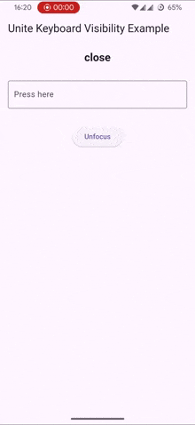

---

A Flutter plugin to detect keyboard visibility across platforms using modern
APIs. Supports floating keyboard and Android 15 predictive back gesture.

Only Android and iOS are supported at the moment. On iOS, this plugin falls back
to an implementation based on
[flutter_keyboard_visibility](https://pub.dev/packages/flutter_keyboard_visibility)
until I have time to write my own implementation. Pull requests are welcome.

WASM support is planned.

Desktop platforms like macOS, Windows and Linux are not planned. Still, you are
welcome to make contributions in this regard.

<table width="100%">
  <thead>
    <tr>
      <th width="33%">Basic open-close</th>
      <th width="33%">Predictive back</th>
      <th width="33%">Floating keyboard</th>
    </tr>
  </thead>
  <tbody>
    <tr>
      <td width="33%"></td>
      <td width="33%"></td>
      <td width="33%"></td>
    </tr>
  </tbody>
</table>

## Table of Contents

- [Installation](#installation)
- [Usage](#usage)
- [Plugin lifecycle](#plugin-lifecycle)
- [Utility widgets](#utility-widgets)
  - [KeyboardVisibilityUnfocuser](#keyboardvisibilityunfocuser)
  - [KeyboardVisibilityBuilder](#keyboardvisibilitybuilder)
- [Troubleshooting](#troubleshooting)
- [Contributing](#contributing)
- [License](#license)

## Installation

Add the dependency to your `pubspec.yaml`:

```yaml
dependencies:
  unite_keyboard_visibility: ^0.1.2
```

Then get packages:

```bash
dart pub get
```

## Usage

Import and initialize the plugin before accessing visibility:

```dart
import 'package:unite_keyboard_visibility/unite_keyboard_visibility.dart';

void main() async {
  WidgetsFlutterBinding.ensureInitialized();
  await UniteKeyboardVisibility.instance.initialize();

  runApp(const MyApp());
}
```

On Android, this plugin defines 4 states of keyboard visibility: `maybeOpen`,
`maybeClose`, `open` and `close`, which correspond to:

- `maybeOpen`: The keyboard is moving from `close` to `open` **or** return back
  to `close`.
- `maybeClose`: The keyboard is moving from `open` to `close` **or** return back
  to `open`.
- `close`: The keyboard is definitely closed.
- `open`: The keyboard is definitely opened.

The reason `maybeOpen` and `maybeClose` exist is because Android 15 enables
predictive back animation by default, which allows the user to "cancel/reverse"
ongoing keyboard animation. This confuses nearly all visibility detection
methods introduced before Predictive Back in Android 13, which assumed that the
animations/user gestures would not affect the final outcome and thus gave
incorrect or outdated results. While some plugins have been updated to support
this new behavior, more often than not, they try to hide the complexity of
keyboard visibility by using a single `isOpen` boolean, which is not sufficient
to accurately represent the current keyboard state and leads to awkwardness in
their API usage.

Furthermore, older implementations (before Android 11) rely on outdated APIs
that use "bottom inset" to deduce keyboard visibility. This is a flawed approach
and was more of a workaround for the problem at the time. Even though it works
for basic bottom-aligned keyboards, it falls flat on its face when floating
keyboards are involved because now "bottom inset" is always equal to 0, which
corresponds to "close" regardless of whether the keyboard is actually closed or
not.

This plugin uses modern APIs which hook directly into the underlying native
platform keyboard states and animations ([see
here](https://developer.android.com/develop/ui/views/layout/sw-keyboard)),
allowing you to access exactly at any given time what the current keyboard
visibility is, and whether it is ephemeral (`maybeOpen`, `maybeClose`) or stable
(`open`, `close`). It does not try to hide the complexity of keyboard visibility
and trusts you to make conscious decisions about how to handle it in your own
app.

On iOS, because the user can't "cancel" the keyboard animation like on Android,
`maybeOpen` and `maybeClose` are not needed. Therefore, only `open` and `close`
states are emitted on iOS.

To access the current visibility:

```dart
final visibility = UniteKeyboardVisibility.instance;
final status = visibility.value;

print('Keyboard is $status');
```

Listen to visibility changes, the current value will be emitted immediately for
any new listener:

```dart
visibility.valueStream.listen((status) {
  print('Keyboard visibility changed: $status');
});
```

## Plugin lifecycle

### initialize

```dart
Future<void> initialize({
  bool enableLogging = false,
  bool forceFallback = false,
});
```

Initializes keyboard visibility detection.

- `enableLogging`: Enables internal logging. May affect performance. Defaults to
  `false`.
- `forceFallback`: Forces the fallback implementation
  ([flutter_keyboard_visibility](https://pub.dev/packages/flutter_keyboard_visibility))
  on Android. Has no effect on iOS. Defaults to `false`.

### Dispose

```dart
Future<void> dispose();
```

Closes stream and releases all plugin resources.

## Utility widgets

For developers who want a one and done solution, this plugin provides a couple
of useful widgets to help you handle some common use cases.

### KeyboardVisibilityUnfocuser

Auto unfocus any primary focused widget (for example TextField) when keyboard
closes.

Simply wrap your app's root widget with `KeyboardVisibilityUnfocuser`:

```dart
KeyboardVisibilityUnfocuser(
  child: const MyApp(),
)
```

You can also customize the unfocus behavior by providing a `defaultUnfocusMode`,
or disable unfocusing entirely with `enableUnfocusing`:

```dart
KeyboardVisibilityUnfocuser(
  // Set to false to disable automatic unfocusing
  enableUnfocusing: true,
  // Choose when to unfocus:
  // eager (as soon as keyboard starts closing) or lazy (after it fully closes)
  defaultUnfocusMode: KeyboardVisibilityUnfocusMode.eager,
  child: const MyApp(),
)
```

To customize unfocusing for individual focusable, use
`KeyboardVisibilityFocusNode`:

```dart
class MyWidget extends StatefulWidget {
  @override
  State<MyWidget> createState() => _MyWidgetState();
}

class _MyWidgetState extends State<MyWidget> {
  // Initialize the KeyboardVisibilityFocusNode.
  final focusNode = KeyboardVisibilityFocusNode(
    unfocusMode: KeyboardVisibilityUnfocusMode.eager,
  );

  @override
  void dispose() {
    // Dispose the focusNode when the widget is disposed.
    focusNode.dispose();
    super.dispose();
  }

  @override
  Widget build(BuildContext context) {
    return TextField(
      focusNode: focusNode,
    );
  }
}
```

### KeyboardVisibilityBuilder

Build a widget that depends on keyboard visibility.

```dart
KeyboardVisibilityBuilder(
  builder: (context, status, child) {
    return Text(
      status == KeyboardVisibilityStatus.open
          ? 'Keyboard is visible.'
          : 'Keyboard is hidden.',
    );
  },
);
```

## Troubleshooting

- Ensure you call `initialize()` before using `value` or `valueStream`, or a
  `StateError` will be thrown when you try to access any plugin resources.
- Use `forceFallback` on Android if the native implementation does not detect
  visibility correctly. This option will be removed once the plugin reaches
  stable (ideally with full Android, iOS and WASM support).

## Contributing

Contributions are welcome! Please open issues and PRs on
[GitHub](https://github.com/VinhNgT/unite_keyboard_visibility).

## License

[MIT](LICENSE)
